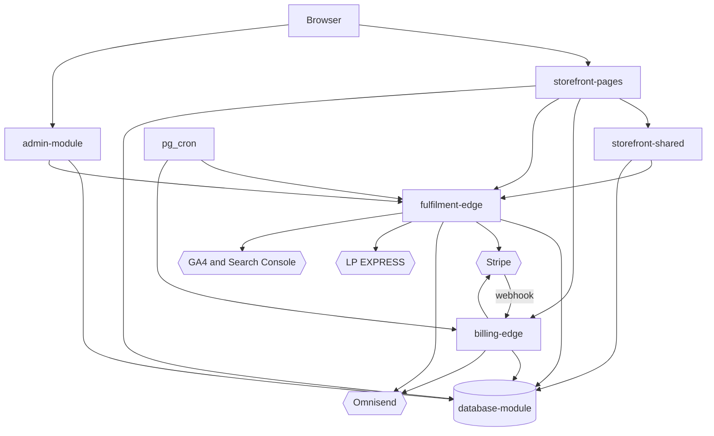

# Codebase map

Index of the modules of `bricks` (BRICKTIME). Full per-module tables with file:line, signatures and callers are split into `architecture/modules/` because the combined map would exceed 600 lines. Tables sit between `<!-- auto:start -->` and `<!-- auto:end -->` markers; reruns replace only those and keep hand-written notes.

## Modules

| Module | Path | Purpose | Depth | Notes |
|---|---|---|---|---|
| storefront-pages | `src/pages/` | one component per route, orchestrates data and edge calls | unclear (3 pages of 1400 to 2100 lines) | [[storefront-pages]] |
| storefront-shared | `src/components/`, `contexts/`, `hooks/`, `lib/`, `data/` | UI, state, data hooks, clients | mixed: `waitForSubscriberBilling`, `useCredits`, `lib/lpexpress.ts` deep; `useAuth`, `useSubscriptions` shallow | [[storefront-shared]] |
| billing-edge | `supabase/functions/` (stripe-webhook, create-checkout, change-subscription, cancel, pause, process-plan-changes, billing-portal, billing-history, penalty, `_shared/{plan-*,downgrade-guard,coupon,vat}`) | subscription lifecycle and payments | deep behind small bodies, but rules spread over the set | [[billing-edge]] |
| fulfilment-edge | `supabase/functions/` (gift card, merch, lpexpress, lpexpress-sync, omnisend-subscribe, delete-*, get-analytics, `_shared/lpexpress.ts`) | one-off purchases, logistics, account deletion, analytics proxy | `lpexpress` deep; others shallow wrappers | [[fulfilment-edge]] |
| database-module | `supabase/migrations/` | schema, RLS, RPCs, triggers, cron | deep (rules live in triggers), history incomplete | [[database-module]] |
| admin-module | `admin/` | operator back office (18 routes) | unclear (page-per-table CRUD) | [[admin-module]] |
| vault and tooling | `obsidian/`, `.claude/`, `.codex/`, `.agents/` | docs and agent config | n/a | not documented here |

## Inventory counts (at `a985f7f`)

| Area | Count |
|---|---|
| Storefront routes / page components | 22 routes, 23 page components (incl. ComingSoon) |
| Storefront components (non-ui) | about 75, plus 13 `components/ui` |
| Hooks / contexts | 14 hooks, 4 contexts |
| `src/lib` modules | 18 files |
| Edge functions | 19 (new: `create-rental-courier-checkout`), plus 6 `_shared` modules (2 with tests) |
| Stripe webhook events handled | 7 (unchanged; `checkout.session.completed` and `async_payment_succeeded` gained a `rental_courier` branch) |
| Migrations | 109 files, 29 tables, 6 views, 150 `create policy` statements |
| Admin routes | 18 |

`package.json` scripts: `dev`, `build` (runs admin build too), `lint`, `typecheck`, `format`, `preview`. No test script; edge function tests are `deno test` files (`_shared/plan-change_test.ts`, `plan-schedule_test.ts`).

## Domain terms (proposed glossary, no `GLOSSARY.md` exists)

Plan (tier), Brick budget (credits), Held set, Rental / Order, Drop (product page), Archive (catalog), Terminal vs Courier, Return, Pause, Penalty, Gift card, Coupon, Merch order, Check-in, Achievement, Leaderboard. Note the DB says `plans` where the UI says "subscriptions".

## Related

[[system-overview]] · [[integrations]] · [[deepening-candidates]] · [[decisions-from-chat]] · [[data-flow]]
