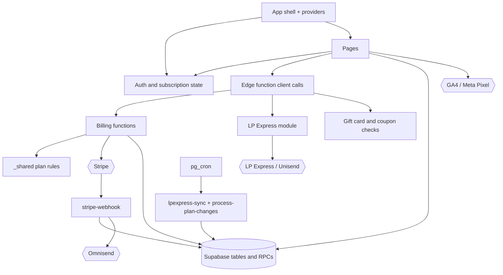

# Codebase map

Catalog of the BRICKTIME storefront (`vite-app`): React SPA in `src/`, Deno edge functions in `supabase/functions/`, SQL in `supabase/migrations/`. The `admin/` app is a separate app and is **not** documented here (see Conflicts in [[deepening-candidates]] about how it is tracked). First full run; generated tables sit between `auto:` markers and are replaced on reruns. Hand-written notes outside the markers are kept.

## Modules

| Module                      | Path                                                                                                                                                                                       | Purpose                                                                               | Depth                                | Owner notes          |
| --------------------------- | ------------------------------------------------------------------------------------------------------------------------------------------------------------------------------------------ | ------------------------------------------------------------------------------------- | ------------------------------------ | -------------------- |
| App shell                   | `src/main.tsx`, `src/App.tsx`                                                                                                                                                              | providers, routes, consent-gated analytics                                            | shallow (wiring)                     | [[routing]]          |
| Auth and subscription state | `src/contexts/`, `src/hooks/useAuth.ts`, `useSubscriptions.ts`, `useCredits.ts`                                                                                                            | session, subscriber row, plan, budget                                                 | deep                                 | [[hooks]]            |
| Pages                       | `src/pages/`                                                                                                                                                                               | 20 route views; Checkout, Account, Community, Drop, Subscribe are 800-2100 lines each | shallow interface, very large bodies | [[routing]]          |
| Domain helpers              | `src/lib/`                                                                                                                                                                                 | plan branding, filters, Vilnius time, function errors, billing wait                   | mixed                                | [[utils]]            |
| Billing functions           | `supabase/functions/{create-checkout,change-subscription,cancel-subscription,pause-subscription,process-plan-changes,create-billing-portal,get-billing-history,admin-cancel-subscription}` | subscription lifecycle on Stripe                                                      | deep                                 | [[api-architecture]] |
| Stripe webhook              | `supabase/functions/stripe-webhook/`                                                                                                                                                       | single writer of paid state into the DB                                               | deep                                 | [[api-architecture]] |
| One-off checkouts           | `supabase/functions/{create-merch-checkout,create-gift-card-checkout,create-penalty-checkout,create-rental-courier-checkout,verify-gift-card}`                                             | merch, gift cards, penalties, paid courier                                            | unclear                              | [[api-architecture]] |
| Shared plan rules           | `supabase/functions/_shared/`                                                                                                                                                              | plan-change maths, schedules, VAT, coupons, downgrade guard                           | deep                                 |                      |
| LP Express module           | `supabase/functions/{lpexpress,lpexpress-sync}`, `_shared/lpexpress.ts`, `src/lib/lpexpress.ts`                                                                                            | parcel lockers, labels, tracking                                                      | deep                                 |                      |
| Account lifecycle           | `supabase/functions/{delete-account,delete-subscriber}`                                                                                                                                    | deletion of members                                                                   | shallow                              |                      |
| Marketing and analytics     | `omnisend-subscribe`, `get-analytics`, `src/lib/analytics.ts`                                                                                                                              | waitlist to Omnisend, GA4/GSC reads for admin, browser tags                           | shallow                              | [[welcome-email]]    |
| Database                    | `supabase/migrations/`                                                                                                                                                                     | schema, RLS (about 150 policy statements), RPCs, cron                                 | deep                                 | [[database]]         |

## Dependency order

App shell → Auth and subscription state → Pages → (client calls) → edge functions → Stripe / LP Express / Omnisend → Database.

---

### App shell — `src/main.tsx`, `src/App.tsx`

Purpose: nest providers and declare routes. Domain terms: consent, coming-soon gate.
Interface: providers wrap in the order Consent → Auth → Subscriptions (`src/main.tsx:36-44`; the Merch and Rental cart providers now nest inside Subscriptions, `main.tsx:42-43`); `App` mounts the routes and calls `trackPageview` on navigation.
Depends on: Auth and subscription state, external: GA4, Meta Pixel.
Used by: browser entry.

<!-- auto:start module=app-shell -->

| Route                                                                  | File:line         | Element                                    | Does                          |
| ---------------------------------------------------------------------- | ----------------- | ------------------------------------------ | ----------------------------- |
| `/`                                                                    | src/App.tsx:60    | Home                                       | landing                       |
| `/archive`                                                             | src/App.tsx:61    | Archive                                    | product catalog               |
| `/account`                                                             | src/App.tsx:62    | Account                                    | profile, plan, payments       |
| `/nustatyti-slaptazodi`                                                | src/App.tsx:63    | ResetPassword                              | password reset                |
| `/community`                                                           | src/App.tsx:64    | Community                                  | feed, challenges, leaderboard |
| `/subscribe`                                                           | src/App.tsx:65    | Subscribe                                  | plan picker and signup        |
| `/checkout`                                                            | src/App.tsx:66    | Checkout                                   | rental claim and delivery     |
| `/drop/:id`                                                            | src/App.tsx:67    | Drop                                       | product detail                |
| `/profile/:userId`                                                     | src/App.tsx:68    | UserProfile                                | public profile                |
| `/merch`, `/merch/krepselis`, `/merch/aciu`, `/merch/:slug`            | src/App.tsx:71-75 | MerchPage, MerchCart, MerchThankYou, MerchDrop | merch shop and merch cart |
| `/rinkiniai/krepselis`                                                 | src/App.tsx:73    | RentalCart                                 | set (rental) cart, claims several sets |
| `/gift-cards`                                                          | src/App.tsx:72    | GiftCards                                  | gift card purchase            |
| `/duk`, `/praleisti-pristabdyti`, `/pristatymas`, `/grazinimai`        | src/App.tsx:73-76 | HelpPages                                  | FAQ, pause, shipping, returns |
| `/apie`, `/kontaktai`, `/privatumo-politika`, `/parduotuves-taisykles` | src/App.tsx:77-80 | About, Contacts, PrivacyPolicy, StoreRules | static and legal              |
| `*`                                                                    | src/App.tsx:81    | NotFound                                   | 404                           |

<!-- auto:end -->

### Auth and subscription state — `src/contexts/`, `src/hooks/`

Purpose: hold the Supabase session, the caller's `subscribers` row and the derived budget. Domain terms: subscriber, plan tier, credits (€ budget), held value.
Interface: read via `useAuth`, `useSubscriptions`, `useCredits`; the contexts must be mounted under the providers in `src/main.tsx`. `useCredits` calls RPC `used_credits`.
Depends on: Database, external: Supabase Auth.
Used by: all pages and Nav.

<!-- auto:start module=state -->

| Function / export                                   | File:line                                   | Signature (one line)        | Does                                          | Called from                                                                    |
| --------------------------------------------------- | ------------------------------------------- | --------------------------- | --------------------------------------------- | ------------------------------------------------------------------------------ |
| `AuthProvider` / `useAuthContext`                   | src/contexts/AuthContext.tsx:24,95          | provider + context hook     | session, user, profile; `refreshProfile` is memoised on the user id | main.tsx                                                                       |
| `SubscriptionsProvider` / `useSubscriptionsContext` | src/contexts/SubscriptionsContext.tsx:13,43 | provider + context hook     | shared subscriber row                         | main.tsx                                                                       |
| `ConsentProvider` / `useConsentContext`             | src/contexts/ConsentContext.tsx:36,74       | provider + context hook     | cookie consent, loads GA and Pixel            | main.tsx                                                                       |
| `BreadcrumbProvider` / `useBreadcrumbLabel`         | src/contexts/BreadcrumbContext.tsx:10,19    | label slot                  | breadcrumb text                               | Breadcrumb                                                                     |
| `useAuth`                                           | src/hooks/useAuth.ts:13                     | `() => ...`                 | auth actions                                  | AuthContext, Subscribe, MerchDrop, ProductReviews, useCredits, useDailyCheckin |
| `useSubscriptions`                                  | src/hooks/useSubscriptions.ts:24            | `() => ...`                 | plans and subscriber row                      | Checkout, Account, Subscribe, Subscriptions, useCredits                        |
| `useCredits`                                        | src/hooks/useCredits.ts:17                  | `() => CreditsState`        | budget, used (RPC `used_credits`), remaining, over-budget | Checkout, Account, Nav                                                         |
| `MerchCartProvider` / `useMerchCart`                | src/contexts/MerchCartContext.tsx:63; src/hooks/useMerchCart.ts:5 | provider + hook | merch cart lines (max 6 lines, qty ≤10 each, `MERCH_CART_MAX_LINES`/`_QUANTITY`) | main.tsx:42, MerchDrop, MerchCart, Nav |
| `RentalCartProvider` / `useRentalCart`              | src/contexts/RentalCartContext.tsx:45; src/hooks/useRentalCart.ts:5 | provider + hook | set cart (max 10 sets, `RENTAL_CART_MAX_SETS`); `addToRentalCart` returns `"added"`/`"full"` | main.tsx:43, Drop, RentalCart, Nav |
| `useCreditsReset`, `CreditsResetNotice` | src/hooks/useCreditsReset.ts:16; src/components/CreditsResetNotice.tsx:12 | hook / component | **Merged (PR #143, `22e693f`; in HEAD `6ad2d2b`).** `179d56d`: reads RPCs `billing_window` and `credits_pending_reset`; `CreditsResetNotice` shows a countdown ("Kreditai atsistatys po …") while returned sets still hold credits, else a "return active sets" hint; reloads the window when the countdown ends; fails quiet (null window / 0 pending on RPC error) | Account.tsx, Checkout.tsx, RentalCart.tsx (only when over budget) |
| `useSavedTerminal`                                  | src/hooks/useSavedTerminal.ts:16 | hook | remembered parcel terminal | MerchDrop, MerchCart, RentalCart |
| `useDailyCheckin`                                   | src/hooks/useDailyCheckin.ts:38             | `() => DailyCheckin`        | daily check-in, RPC `refresh_my_achievements` | App, Community, DailyCheckinBanner                                             |
| `useAchievements`                                   | src/hooks/useAchievements.ts:5              | `() => ...`                 | achievements                                  | Community, Account, UserProfile                                                |
| `useDiscountCode`                                   | src/hooks/useDiscountCode.ts:16             | `() => ...`                 | validates a code via `verify-gift-card`       | Account                                  |
| `useProductAvailability`                            | src/hooks/useProductAvailability.ts:9       | `() => ...`                 | view `product_availability`                   | Drop, Checkout, Archive, FeaturedProducts                                      |
| `useProductRatings`, `RatingBadge`, `ProductRating` | src/hooks/useProductRatings.ts:54; src/components/reviews/RatingBadge.tsx:12 | hook / component | `95a609c`: one shared, 5-minute cached query of approved `product_reviews` (`product_id, rating`, limit 10000) averaged per set; badge renders nothing without reviews | ProductCard, Drop |
| `usePaidCourierReturn`                              | src/hooks/usePaidCourierReturn.ts:13        | hook                        | paid courier return state                     | Checkout                                                                       |
| `useCategories`                                     | src/hooks/useCategories.ts:12               | `() => string[]`            | product categories                            | Archive, FeaturedProducts                                                      |
| `usePublicStats`                                    | src/hooks/usePublicStats.ts:14              | `() => PublicStats or null` | view `public_stats`                           | FAQ, Hero                                                                      |
| `useSiteAccess`                                     | src/hooks/useSiteAccess.ts:14               | hook                        | coming-soon gate (`VITE_SITE_ACCESS_CODE`)    | ComingSoonGate                                                                 |
| `useSiteGateEnabled` | src/hooks/useSiteGateEnabled.ts:8 | `() => boolean or null` | `de535e2`: reads `site_settings.coming_soon_gate`; null while loading; fails closed (true) on a read error. `03e2ea6`: the read aborts after 5 s (`LOAD_TIMEOUT_MS`, `AbortSignal.timeout`) and then also fails closed | ComingSoonGate (`src/components/ComingSoonGate.tsx:6`: renders children when code granted or gate off, nothing while loading, else `ComingSoon`) |
| `useLegalPage`                                      | src/hooks/useLegalPage.ts:20                | `(slug)`                    | table `legal_pages`                           | StoreRules, PrivacyPolicy                                                      |
| `usePageHeaderImage`                                | src/hooks/usePageHeaderImage.ts:7           | `(slug)`                    | table `page_headers`                          | Merch, GiftCards, Archive                                                      |
| `useReveal`                                         | src/hooks/useReveal.ts:3                    | `<T extends HTMLElement>()` | GSAP reveal                                   | components                                                                     |

<!-- auto:end -->

### Domain helpers — `src/lib/`

Purpose: Supabase client, plan branding, filters, time, error and billing-wait helpers.
Interface: never add hand-written exports to `src/lib/database.types.ts` (see `src/lib/db-enums.ts`; rule in `CLAUDE.md`).
Depends on: external: Supabase. Used by: pages and hooks.

<!-- auto:start module=lib -->

| Function / export                                                     | File:line                                | Signature (one line)     | Does                                             | Called from                                                   |
| --------------------------------------------------------------------- | ---------------------------------------- | ------------------------ | ------------------------------------------------ | ------------------------------------------------------------- |
| `supabase`                                                            | src/lib/supabase.ts:7                    | `createClient<Database>` | browser client                                   | everywhere                                                    |
| `waitForSubscriberBilling`                                            | src/lib/wait-for-subscriber.ts:19        | async                    | polls until the webhook wrote the subscriber row | Checkout, Account, Subscribe                                  |
| `readFunctionError`                                                   | src/lib/function-error.ts:6              | async                    | reads an edge function error body                | Checkout, Account, MerchDrop, Subscribe                       |
| `getDisplayPlan`, `sortPlans`                                         | src/lib/product-filters.ts:29,39         | fn                       | plan labels and order                            | Checkout, Drop, ProductCard                                   |
| `getSubscriptionDisplayName/BrickImage/Theme/BrickSvg`                | src/lib/subscription-branding.ts:116-131 | fn                       | plan branding                                    | Drop, Community, ProductCard                                  |
| `getVilniusParts`, `formatReleaseMonth(+First)`                       | src/lib/vilnius-time.ts:38,52,59         | fn                       | Europe/Vilnius time                              | pages                                                         |
| `optimiseImage`                                                        | src/lib/optimise-image.ts:41             | `(file: File) => Promise<File>` | shrinks JPEG/PNG/WebP to WebP, max 1600 px; returns the original for GIF/SVG/animated or if not smaller | `src/pages/Community.tsx:825`, `admin/src/lib/upload-to-storage.ts:14` (own copy in `admin/src/lib/optimise-image.ts`) |
| `toRentalErrorMessage`                                                | src/lib/rental.ts:3                      | `(reason: string) => string` | maps rental/claim error reasons to Lithuanian copy | Checkout, RentalCart, Drop |
| `downloadGiftCardPdf`                                                 | src/lib/gift-card-pdf.ts:55              | async                    | gift card PDF                                    | GiftCards                                                     |
| `translateAuthError`                                                  | src/lib/auth-errors.ts:18                | fn                       | Lithuanian auth errors                           | AuthForm (Account logged-out view, Checkout, Community)                                                    |
| `getAnonSessionId`, `getAnonLikedIds`, `toggleAnonLikedId`            | src/lib/anonSession.ts:4,13,22           | fn                       | anonymous likes                                  | Community                                                     |
| `parseHeadingMarkup`                                                  | src/lib/heading-markup.ts:10             | fn                       | CMS heading markup                               | HeadingMarkup                                                 |
| `loadGoogleAnalytics`, `loadMetaPixel`, `trackPageview`, `trackEvent` | src/lib/analytics.ts:23,40,63,68         | fn                       | browser tags                                     | ConsentContext, App; `trackEvent` has no caller found by `rg` |

<!-- auto:end -->

### Pages — `src/pages/`

Purpose: route views. Lines: Checkout 2200, Account 1328, Community 1460, Drop 1013, Subscribe 801. These contain the client side of the billing flow.
Interface: call edge functions with `supabase.functions.invoke` (`create-checkout`, `change-subscription` from Account/Checkout/Subscribe; `verify-gift-card` from hooks and merch).
Depends on: Auth and subscription state, Billing functions, LP Express module.
Used by: routes in App shell.
Plan-change routing (as of `ba8c33b`): the two "Pasirinkti planą" buttons for members without a plan now `navigate("/subscribe")` (`Account.tsx:996`, `:1200`) instead of going to checkout; `goToPlanCheckout` (`Account.tsx:693`) is only used for members who already have a plan (next plan up, else the current one). Earlier (`195f18a`): `Account.tsx` no longer holds a plan-change flow. Its in-place upgrade/downgrade UI (`startPlanChange`, `handleUpgradeCheckout`, `PlanChangeConfirm`, terminal/discount state) was removed; the plan picker only does `navigate(`/checkout?plan=<key>&billing=monthly`)` (`Account.tsx:698`). All plan purchases and changes now run through `Checkout.tsx`: `selectPlan` (plan pills rewrite `?plan=`), `isPlanDowngrade` (plan-only checkout where the target price is below the current plan) and the `swap.scheduled` branch, which redirects to `/account` because a cheaper plan waits for the next renewal. A same-plan, same-delivery attempt returns "Jau esi šiame plane.". A plan-only purchase ends on `/account?plan_changed=true&plan=<key>`; Account's `plan_changed` handler (`Account.tsx:378`) clears the URL and waits for the webhook via `waitForSubscriberBilling`. A purchase with a product still returns to `/checkout?product=...&success=true`. `Checkout.tsx` now also renders `VatNote`.
Orphans removed in `6976de2`: `PlanChangeSummary.tsx` and `DiscountCodeField.tsx` are deleted (they had no importers). New since `ba8c33b`: `CancelSubscriptionDialog` (`src/components/account/CancelSubscriptionDialog.tsx:19`, confirm dialog, used by `Account.tsx:1320`); `PlanChangeConfirm` (`src/components/checkout/PlanChangeConfirm.tsx:52`, used by `Checkout.tsx:2089`) now shows a breakdown (new plan, unused time or old plan price, credit, total with PVM) from `PlanChangeQuote.oldPlanCreditCents` / `newPlanChargeCents`, which `previewUpgrade` in `change-subscription` fills (`index.ts:212-266`, flat-diff path and Stripe proration path). `useCredits` no longer returns `returnedHeldCredits` or `budgetFreesAt` (`rg` finds no users); it reads only RPC `used_credits`, and a failed RPC now counts as 0 used.
Admin plan prices: `fetchPlanPrices` (`admin/src/lib/plan-prices.ts:5`, `() => Promise<Record<string, number>>`) reads `plans(id, price)`; used by admin `Dashboard.tsx` (MRR) and `Subscribers.tsx` (monthly spend) in place of two hardcoded `PLAN_PRICES` maps. Returns `{}` on error, so MRR then shows 0 silently (console.error only).
VAT note: `VatNote` (`src/components/VatNote.tsx:5`, `({ className? }) => JSX`) renders "Visos kainos nurodytos su PVM"; used by `Subscriptions.tsx`, `Subscribe.tsx`, `Account.tsx` (plan picker) and `MerchDrop.tsx`. Its copy must stay true to `supabase/functions/_shared/vat.ts` (prices stored gross, 21% PVM split by Stripe).

Login entry (as of `2f9b09a`): the Nav avatar popover with an inline `AuthForm` is gone. `AvatarLink` (`src/components/Nav.tsx:46`) is now always a `<Link to="/account">` (icon when logged out, avatar when logged in). The logged-out branch of `Account` (`src/pages/Account.tsx:754`) renders `AuthForm` in a card, with `Seo noindex` and waits on `useAuth().loading` before showing it. `AuthForm` is now rendered from `Account.tsx`, `Checkout.tsx:2157` and `Community.tsx:1461`; `Nav.tsx` no longer imports it or `ui/popover`.
Carts (2026-11-19, `36ec075`..`a82d3e4`): `MerchCart.tsx` (`:36`) posts all lines in one `create-merch-checkout` call (`items[]`, one Stripe session). `RentalCart.tsx` (`:32`) has two paths: plan-included or terminal delivery calls RPC `claim_rentals` (`:218`, several sets in one transaction); paid courier delivery calls `create-rental-courier-checkout` (`:198`) with one `RENTAL_COURIER_FEE` (€3, `src/lib/rental.ts:3`) for the whole cart, and `stripe-webhook` then creates the rentals through `record_paid_courier_rentals` (`usePaidCourierReturn` handles the return, also used by `Checkout.tsx`). `BricksBudgetBar` (`src/components/rental/BricksBudgetBar.tsx:12`) is the budget progress bar; `ProductCardCartButton` (`src/components/ProductCardCartButton.tsx:17`) is the catalogue add-to-cart button; `RentalCartButton` (`src/components/RentalCartButton.tsx:14`) adds from `Drop`. `MerchThankYou.tsx` reads `get_merch_order_by_session` then `get_merch_order_lines_by_session`. This replaces the earlier note that the set cart had no paid courier (it was true at `36ec075`, superseded by `5dbc994`). Migrations `20261119180000_cart_review_fixes.sql` and `20261119190000_merch_order_items_order_id_index.sql` are applied live (from status, 2026-11-19, unverified). Round-3 review (`41678c5`): `ProductCardCartButton` takes a `title` prop and disables itself at `RENTAL_CART_MAX_SETS`; `RentalCart` selects `products.status` (a `sold_out` set counts as "taken"), puts the paid set ids in the success URL (`&sets=`) so only those leave the cart after payment instead of `clear()`, and links "Pasirink didesnį planą" when over budget on a non-mega plan. Merge state (2026-11-19, `52c4de3`): `feat/merch-cart` (PR #124), `perf/image-optimisation` (PR #126) and `feat/lp-parcel-options` (PR #125) are all merged into HEAD, so the earlier branch divergence is gone: `ProductCard` has a card-wide `Link` at `z-20` (`ProductCard.tsx:225`, `a462e99`) with `ProductCardCartButton` above it, `RentalCart` has the `&sets=` handling, and `optimiseImage` (`src/lib/optimise-image.ts`, `admin/src/lib/optimise-image.ts`) plus `admin/src/lib/upload-to-storage.ts` (`bucket`, one-year `cacheControl`) are present together. `1aaa744`: `ProductEditDialog` appends uploaded gallery URLs through a functional `setForm` (`appendToGallery`); `Merch.tsx` `MerchCardSkeleton` image uses `aspect-[4/3]`; `MerchCard` image frame is `aspect-[4/5]` on mobile and `md:aspect-[4/3]`, but stays `4/3` on mobile when the item has no `image_url` (`bbaacca`, `Merch.tsx:98`); `MerchCardSkeleton` matches it (`aspect-[4/5] md:aspect-[4/3]`, `Merch.tsx:170`). Revert script for the product image backfill: `supabase/rollbacks/20261119_product_images_webp_backfill_revert.down.sql` (renamed to the rollbacks convention in `b5c6381`).

Table access (counts of `.from(...)` in `src` and functions): `subscribers` 63, `gift_cards` 19, `orders` 14, `products` 10, `feed_items` 10, `coupons` 8, `plans` 7, `home_content` 6.

### Billing functions — `supabase/functions/`

Purpose: Stripe-backed subscription lifecycle. Domain terms: plan, held set, pending plan, schedule, pause, cancel_requested.
Interface: all take the caller JWT except `process-plan-changes` (header `x-cron-secret`, checked against `public.cron_secrets`) and `stripe-webhook` (`verify_jwt = false`, `supabase/config.toml:65`). Errors are JSON `{ error }`.
Depends on: Shared plan rules, external: Stripe, Supabase.
Used by: Account, Checkout, Subscribe pages; admin app; pg_cron.

<!-- auto:start module=billing -->

| Function / export           | File:line                                                | Signature (one line) | Does                                                  | Called from                                         |
| --------------------------- | -------------------------------------------------------- | -------------------- | ----------------------------------------------------- | --------------------------------------------------- |
| `create-checkout`           | supabase/functions/create-checkout/index.ts:33           | `Deno.serve` POST    | opens a subscription Checkout session                 | Account, Checkout, Subscribe                        |
| `change-subscription`       | supabase/functions/change-subscription/index.ts:296      | `Deno.serve` POST    | plan swap with preview, upgrade charge, coupon redeem | Account, Checkout                                   |
| `cancel-subscription`       | supabase/functions/cancel-subscription/index.ts:27       | `Deno.serve` POST    | cancel at period end once sets are returned           | Account, admin `Subscribers.tsx` |
| `pause-subscription`        | supabase/functions/pause-subscription/index.ts:30        | `Deno.serve` POST    | pause 1-3 renewals (RPC `begin_subscription_pause`)   | Account |
| `process-plan-changes`      | supabase/functions/process-plan-changes/index.ts:211     | `Deno.serve` cron    | applies pending plans and cancels                     | pg_cron; schedule not in migrations (TODO: unknown) |
| `create-billing-portal`     | supabase/functions/create-billing-portal/index.ts:63     | `Deno.serve` POST    | Stripe portal for cards and invoices only             | Account, Checkout |
| `get-billing-history`       | supabase/functions/get-billing-history/index.ts:49       | `Deno.serve`         | invoice list for the account page                     | Account |
| `admin-cancel-subscription` | supabase/functions/admin-cancel-subscription/index.ts:27 | `Deno.serve` POST    | admin cancels at Stripe, then sets row `cancelled`    | admin `Subscribers.tsx`                             |

<!-- auto:end -->

### Stripe webhook — `supabase/functions/stripe-webhook/`

Purpose: turn Stripe events into database state. Handles `checkout.session.completed`, `checkout.session.async_payment_succeeded`, `customer.subscription.created/updated/deleted`, `invoice.paid`, `invoice.payment_failed` (`index.ts:917-1075`). For `customer.subscription.*` (except `deleted`) it re-reads the live subscription with `stripe.subscriptions.retrieve` instead of trusting the event snapshot, because Stripe does not order events (`index.ts:1015-1022`).
Interface: signature checked with `STRIPE_WEBHOOK_SECRET`; non-2xx makes Stripe retry, so handlers return false only for retry-worthy failures (comment at `index.ts:64`).
Depends on: external: Stripe, Omnisend (`pushOmnisendEvent`), RPCs `redeem_coupon`, `record_merch_cart_order`, `record_paid_courier_rental`, `record_paid_courier_rentals`.
Used by: Stripe only.

<!-- auto:start module=webhook -->

| Function / export                                             | File:line            | Signature (one line) | Does                                               | Called from                |
| ------------------------------------------------------------- | -------------------- | -------------------- | -------------------------------------------------- | -------------------------- |
| `Deno.serve`                                                  | index.ts:917         | handler              | verify signature, dispatch by event type           | Stripe                     |
| `pushOmnisendEvent`                                           | index.ts:66          | async                | sends an Omnisend event, reports retryable failure | handlers                   |
| `handleGiftCardCheckout`                                      | index.ts:107         | async                | marks a bought gift card paid                      | webhook                    |
| `handleMerchCheckout`                                         | index.ts:171         | async                | records merch order via RPC `record_merch_cart_order` (`:192`), reads `merch_order_items` for the Omnisend event | webhook                    |
| `redeemMerchGiftCard`, `countMerchCoupon`, `deleteCouponHold` | index.ts:248,278,306 | async                | spends code and releases hold                      | handleMerchCheckout        |
| `handleRentalCourierCheckout`                                 | index.ts:325         | async                | creates the rental after the courier fee is paid   | webhook                    |
| `handleMysteryCourierCheckout` | index.ts:424 | async | `b2ab66f`, `b388322`: on paid `mystery_courier` sessions calls RPC `record_paid_mystery_courier`; refuses-and-refunds on codes in `RENTAL_REFUSED_CODES` (idempotency key `mystery-courier-refund-<session>`); before the refund upserts the session into `rejected_checkout_sessions` and throws if that write fails, throws otherwise so Stripe retries; wired in `checkout.session.completed` and `async_payment_succeeded` | stripe-webhook handler |
| `handlePenaltyCheckout`                                       | index.ts:368         | async                | settles a penalty                                  | webhook                    |
| `findSubscriber`, `isStoredSubscriptionOtherLive`             | index.ts:443,490     | async                | match Stripe ids to a subscriber                   | handlers                   |
| `updateSubscriberByStripeIds`                                 | index.ts:624         | async                | writes plan and status                             | subscription events        |
| `handleSubscriptionCheckout`                                  | index.ts:742         | async                | first subscription purchase                        | webhook                    |
| `sendWelcomeEvent`                                            | index.ts:861         | async                | Omnisend welcome event                             | handleSubscriptionCheckout |

<!-- auto:end -->

### One-off checkouts — `supabase/functions/`

Purpose: Stripe Checkout for merch, gift cards, penalties and paid courier rentals; gift card and coupon verification.
Interface: sessions use Stripe's shortest lifetime and a slightly longer hold on the gift card or coupon (comment in `create-checkout/index.ts:16`, `create-merch-checkout/index.ts:14`). Rejected gift cards return one message so nothing is revealed (`create-merch-checkout/index.ts:232`).
Depends on: Shared plan rules, Stripe. Used by: MerchDrop, GiftCards, Checkout, Stripe webhook.

<!-- auto:start module=oneoff -->

| Function / export                | File:line                                  | Signature (one line) | Does                              | Called from                                 |
| -------------------------------- | ------------------------------------------ | -------------------- | --------------------------------- | ------------------------------------------- |
| `create-merch-checkout`          | create-merch-checkout/index.ts:26          | `Deno.serve` POST    | merch Checkout for one item or `items[]` (cart), `parseLines` at `:250`, 21% VAT, delivery | MerchDrop, MerchCart |
| `create-gift-card-checkout`      | create-gift-card-checkout/index.ts:23      | `Deno.serve` POST    | gift card Checkout                | Checkout |
| `create-penalty-checkout`        | create-penalty-checkout/index.ts:38        | `Deno.serve` POST    | penalty fee Checkout              | Account |
| `create-rental-courier-checkout` | create-rental-courier-checkout/index.ts:56 | `Deno.serve` POST    | courier-fee Checkout for one rental or a whole set cart (`productIds`, max 10, €3 once, dry run of `record_paid_courier_rentals`) | Checkout, RentalCart |
| `create-mystery-courier-checkout` | create-mystery-courier-checkout/index.ts:80 | `Deno.serve` POST | `b2ab66f`, `f6d2c81`: returns 400 unless `successUrl`/`cancelUrl` are on `bricktime.lt`, this project's Vercel previews or localhost (`isAllowedReturnUrl`, `:31`); the Checkout Session uses an idempotency key per user and 10-minute bucket (`IDEMPOTENCY_BUCKET_MS`, `:22`) so double clicks reuse one session; dry-runs `record_paid_mystery_courier` as a pre-check, then opens a €3 (`COURIER_FEE_CENTS`) Stripe Checkout with metadata `type: mystery_courier`; the request itself is created by the webhook | MysteryBoxRequestDialog |
| `verify-gift-card`               | verify-gift-card/index.ts:8                | `Deno.serve`         | validates a code                  | `useDiscountCode`, `MerchDiscountCode`      |

<!-- auto:end -->

Callers come from `rg` on the function name in `src/` and `admin/src/`; call style (`invoke` vs `fetch`) was not checked per site.

### Shared plan rules — `supabase/functions/_shared/`

Purpose: rules shared by billing functions. Tests: `plan-change_test.ts`, `plan-schedule_test.ts`.

<!-- auto:start module=shared -->

| Function / export                                                                 | File:line                            | Signature (one line) | Does                                   | Called from                               |
| --------------------------------------------------------------------------------- | ------------------------------------ | -------------------- | -------------------------------------- | ----------------------------------------- |
| `flatUpgradeDiffCents`                                                            | \_shared/plan-change.ts:13           | fn                   | upgrade price difference               | change-subscription                       |
| `fitsWithinCredits`, `getHeldBrickValue`, `releaseSchedule`, `schedulePlanChange` | \_shared/plan-schedule.ts:9,13,27,42 | fn/async             | held value vs budget, Stripe schedules | process-plan-changes, change-subscription |
| `getVatTaxRateId`                                                                 | \_shared/vat.ts:8                    | async                | 21% tax rate id                        | checkouts                                 |
| `applyCoupon`                                                                     | \_shared/coupon.ts:12                | async                | applies a coupon                       | checkouts                                 |
| `assertNoDowngradeWhileHolding`                                                   | \_shared/downgrade-guard.ts:5        | async                | blocks downgrade while sets are held   | change-subscription                       |

<!-- auto:end -->

### LP Express module

Purpose: parcel lockers, shipping labels, tracking via LP Express (Unisend). Domain terms: terminal, label, barcode, return label.
Interface: single endpoint with body `{ action, ...params }`; actions `terminals`, `tracking`, `create-label`, `set-tracking`, `create-return-label`, `label-pdf`, `cancel` (switch in `lpexpress/index.ts:153-470`; `isAdmin` `:75`, `PARCEL_SIZES` `:97`, `returnSize` `:104`, `requireOwnedOrder` `:117`). Order ownership checked in `requireOwnedOrder`; admin check in `isAdmin`. Since `2677e36`: `create-label` and `create-return-label` take optional `orderIds[]` (one parcel for several sets; `create-label` only for admin, siblings must share customer and destination and have no label; a missing/unknown id returns 404); `size` (`XS`–`XL`, validated against `PARCEL_SIZES`) and `weight` are accepted; when `create-return-label` gets no `size`, it reads, per ordered set, `orders.lp_parcel_size` (the locker slot the admin picked outbound), else `products.shipping_size` (missing = `S`); `returnSize` picks the largest and goes one step up only when the sets sit in more than one outbound parcel (distinct `lp_parcel_id`; sets shipped together share one) (`10f692e`, supersedes the `6fe244d` rule of bumping whenever several sets; `create-label` stores `lp_parcel_size` for locker parcels only, `payload.size ?? "M"`, null for courier; migration `20261120100000_orders_lp_parcel_size.sql`, text `XS`–`XL` check; admin `ShipTogetherDialog` prefills the size from the largest `productShippingSize`, `Order.productShippingSize` in `admin/src/data/orders.ts`) (`6fe244d`; migration `20261120090000_products_shipping_size.sql`, `shipping_size` text `XS`–`XL`, default `S`, check constraint; set per set in admin `ProductEditDialog`); `courierPickup` flips locker parcels from `T2T` to `H2T`; `cancel` updates every order sharing the `lp_parcel_id`. Since `48bf10a`: `create-label` accepts admin-only `deliveryMethod:"courier"` (reroutes a locker order to a door using the receiver address from the request; the order row is rewritten to `home_delivery` with that address; non-admin gets 403), and `set-tracking` (admin only, `orderIds[]` + `barcode` matching `BARCODE_PATTERN` `:95`; stores `lp_barcode`/`LABEL_CREATED` for shipments created on the LP site; refuses orders that already have a label). Not yet confirmed: whether LP honours `size` (from status note, 2026-11-19, unverified).
Depends on: external: LP Express. Used by: TerminalPicker, OrderTracking, ReturnDialog, Checkout; admin Orders; pg_cron job `lpexpress-delivery-sync` every 30 minutes.

<!-- auto:start module=lpexpress -->

| Function / export                                                                                              | File:line                                        | Signature (one line) | Does                               | Called from                                 |
| -------------------------------------------------------------------------------------------------------------- | ------------------------------------------------ | -------------------- | ---------------------------------- | ------------------------------------------- |
| `lpexpress`                                                                                                    | supabase/functions/lpexpress/index.ts:136        | `Deno.serve`         | action router                      | `src/lib/lpexpress.ts`                      |
| `lpexpress-sync`                                                                                               | supabase/functions/lpexpress-sync/index.ts:62    | `Deno.serve`         | polls tracking, flips order status (latest event picked by `eventTime()` `:46`, which reads `eventDate` then falls back to `date` when it is empty or unparsable; merged via #145, `d3eaefa`/`471b712`; the browser side reads the same pair in `OrderTracking.tsx` `eventTime` and `LpTrackingEvent.eventDate` `src/lib/lpexpress.ts:22`, so both sides now agree); logs unfamiliar `publicStateType` values (`KNOWN_STATES` `:29`) | pg_cron                                     |
| `listTerminals`, `createLabel`, `createReturnLabel`, `getLabelPdf`, `getTracking`, `cancelShipment`, `ltPhone` | \_shared/lpexpress.ts:149,183,252,287,304,313,32 | async                | LP API client                      | lpexpress, lpexpress-sync                   |
| `fetchTerminals`, `fetchTracking`, `createLabel`, `createReturnLabel`, `fetchLabelPdf`, `downloadPdf`          | src/lib/lpexpress.ts:39,53,66,86,99,112          | async                | browser wrappers (`createReturnLabel` takes `orderIds?`) | TerminalPicker, OrderTracking, ReturnDialog |
| `PARCEL_SIZES`, `ParcelSize`, `toWeightGrams`, `createLabel` (admin copy)                                       | admin/src/lib/lpexpress.ts:29,30,33,40           | const / fn           | admin parcel size, kg to grams, label call with `orderIds`/`courierPickup` | OrderDetailSheet, ShipTogetherDialog |
| `ParcelOptionsFields`                                                                                           | admin/src/components/ParcelOptionsFields.tsx:24  | component            | size / weight / courier-pickup inputs | OrderDetailSheet, ShipTogetherDialog |
| `OrderDetailSheet` cart block (`cartOrders`, `onShipCart`), `MerchOrderDetailSheet` item lines (`merch_order_items`) | admin/src/components/OrderDetailSheet.tsx:30,50; MerchOrderDetailSheet.tsx | component | `31bdc41`: shows the other sets of the same cart with "Ship cart together"; merch sheet lists the items to pack | admin/src/pages/Orders.tsx:417 |
| `MerchOrdersPanel` item lines (`linesByOrder`), Orders table "Ordered together with" (`getCartKey`, `cartGroups`) | admin/src/components/MerchOrdersPanel.tsx:43,157; admin/src/pages/Orders.tsx:34,124 | component | `f842908`: merch list shows a Cart badge and one line per item from `merch_order_items` (limit 5000, client-side grouping); rental list names the other sets of the same cart | admin/src/pages/Orders.tsx |
| `CourierAddress`, `EMPTY_COURIER_ADDRESS`, `validateCourierAddress`, `trimCourierAddress`, `courierOrderPatch`, `setTrackingCode` | admin/src/lib/lpexpress.ts:40,48,57,63,74,106 | types / fns | `48bf10a`: door-delivery address for the admin courier override; local order patch; `set-tracking` call | OrderDetailSheet, ShipTogetherDialog, ManualTrackingForm |
| `CourierOverrideFields`, `ManualTrackingForm` | admin/src/components/CourierOverrideFields.tsx:14; ManualTrackingForm.tsx:12 | component | `48bf10a`: switch + address inputs to send a locker order to the door; form to store a barcode made on the LP site | OrderDetailSheet, ShipTogetherDialog |
| `QuantityStepper` | src/components/merch/QuantityStepper.tsx:11 | component | `0f1ad3d`: quantity picker on the merch product page; `addLine` in `MerchCartContext` now takes optional `quantity` (capped at `MERCH_CART_MAX_QUANTITY`) | MerchDrop |
| `OrderLabelCell` | admin/src/components/OrderLabelCell.tsx:9 | component | `25f1161`: Orders table "Shipping" column; badge "Label generated" when `order.barcode` is set, button downloads the PDF via `fetchLabelPdf`/`downloadPdf` | admin/src/pages/Orders.tsx:236 |
| `ShipTogetherDialog`                                                                                            | admin/src/components/ShipTogetherDialog.tsx:52   | component            | one parcel for several sets of one customer | admin/src/pages/Orders.tsx:364 |
| `CreateOrderDialog` | admin/src/components/CreateOrderDialog.tsx:55 | component | `e75e3cf`: admin places a 30-day rental for an active subscriber (picks customer, then a set via `SetPicker`); inserts into `orders` with `status:'processing'`, `is_mystery` = plan starts with `mystery` (`:135`); maps a "fully rented out" DB error to a message | admin/src/pages/Orders.tsx |
| `SetPicker` | admin/src/components/SetPicker.tsx:41 | component | admin: searchable set list (category, year, plan-allowed filters) that marks sets the customer already received; loads non-sold-out `products` | CreateOrderDialog |
| `MysteryLock`, `isMysteryHidden`, `MYSTERY_TITLE` | src/components/account/MysteryLock.tsx:4; src/components/account/mystery.ts:3,6 | component / fn / const | `e75e3cf`: a Mystery Box order (`is_mystery`) with status `processing` shows a blurred image, lock overlay and the title "Mystery Box" until the status leaves `processing`; `Account.tsx:505` maps `o.is_mystery` to `RentedOrder.isMystery` | RentedOrderCard, RentalHistory |
| `AssignMysterySet` | admin/src/components/AssignMysterySet.tsx:17 | component | `b2ab66f`, `f6d2c81`: admin picks a set (`SetPicker`) for a `requested` order (the Orders table disables status changes on `requested` rows; `OrderDetailSheet` refreshes its parcel-size picker from the assigned set); updates `product_id`, `status:'processing'`, dates (30 days), guarded by `.eq('status','requested')`; maps "fully rented out" to a message | admin/src/components/OrderDetailSheet.tsx:305 |
| `MysteryBoxRequest`, `MysteryBoxRequestDialog`, `useBillingCountdown` | src/components/account/MysteryBoxRequest.tsx:22; src/components/account/MysteryBoxRequestDialog.tsx:47 (`aria-pressed` on locker/courier buttons, `b388322`); src/hooks/useBillingCountdown.ts:6 | components / hook | `b2ab66f`, `f6d2c81` (a failed `billing_window` load shows a retry button; when the countdown ends the window is reloaded; `onRequested` fires once per paid session id; the timer stops at zero): "Order a Mystery Box" card on Account for Mystery plans; reads RPC `billing_window`, blocks while a box is held or one was requested this period, shows a countdown to the window end (format `Nd Nh Nmin`, `bfffc43`); dialog offers free locker (RPC `request_mystery_box`) or paid courier (`create-mystery-courier-checkout`); on return from Stripe (`mystery_paid=true&session_id`) waits for the webhook's order via `usePaidCourierReturn` | src/pages/Account.tsx:1079 |
| `ComingSoonGateCard` | admin/src/components/ComingSoonGateCard.tsx:17 | component | `de535e2`: Settings switch that upserts `site_settings` key `coming_soon_gate` (true/false); shows load/save errors | admin/src/pages/Settings.tsx:47 |

<!-- auto:end -->

### Account lifecycle and marketing — `supabase/functions/`

<!-- auto:start module=misc -->

| Function / export    | File:line                     | Signature (one line) | Does                                                       | Called from                               |
| -------------------- | ----------------------------- | -------------------- | ---------------------------------------------------------- | ----------------------------------------- |
| `delete-account`     | delete-account/index.ts:24    | `Deno.serve`         | member deletes own account; refuses while sets are out     | `DeleteAccountDialog` |
| `delete-subscriber`  | delete-subscriber/index.ts:9  | `Deno.serve`         | admin deletes a member                                     | admin `Subscribers.tsx` |
| `omnisend-subscribe` | omnisend-subscribe/index.ts:9 | `Deno.serve`         | waitlist contact and event to Omnisend                     | `components/coming-soon/WaitlistForm.tsx` |
| `get-analytics`      | get-analytics/index.ts:179    | `Deno.serve`         | reads GA4 and Search Console with a Google service account | admin `Analytics.tsx`                     |

<!-- auto:end -->

### Database — `supabase/migrations/`

Purpose: schema, RLS, RPCs, triggers, cron. 60+ migration files from `20260430000001_initial_schema.sql`; live state also changed through MCP and the SQL editor (see [[status]]).
Interface: tables read by the app are listed under Pages. RLS is on every table by project rule; about 150 policy statements in migrations.

<!-- auto:start module=db -->

| Function / export                                                                           | File:line                                                                                                                 | Signature (one line) | Does                                    | Called from                         |
| ------------------------------------------------------------------------------------------- | ------------------------------------------------------------------------------------------------------------------------- | -------------------- | --------------------------------------- | ----------------------------------- |
| `used_credits`                                                                              | 20261105184103_budget_period_and_pause.sql:32 (redefined in 20261105184405, 20261105190551, 20261105225000, 20261118120000; latest: sum of `products.value` for orders with status <> 'returned') | RPC                  | budget in use; returned sets free it immediately (owner decision, 2026-11-18, see [[status]]) | `useCredits`                        |
| `used_credits` (latest), `credits_pending_reset`, `billing_window` (redefined), `guard_subscriber_billing_columns` (redefined), column `subscribers.credits_reset_at` | 20261121100000_credits_billing_window.sql:130,153,84,20 | RPCs / trigger / column | **Merged (PR #143, `22e693f`).** `179d56d` (client decision 2026-11-20, from the migration header): a returned set keeps its credits until the next billing window start if it shipped (`lp_barcode` set and created in the current window); never-shipped orders free credits at once. `credits_pending_reset` sums the returned-but-counted value. `credits_reset_at` lets an admin reset a window by hand and is read-only for members (guard trigger). Supersedes the "returned sets free budget immediately" rule of `20261118120000` | useCredits, useCreditsReset, admin SubscriberProfileSheet (`:250` writes `credits_reset_at`) |
| `held_brick_value`                                                                          | 20261030140000:19                                                                                                         | RPC                  | value of sets held                      | `_shared/plan-schedule.ts`          |
| `redeem_coupon`, `claim_coupon_hold`                                                        | 20261105220000:37 (claim)                                                                                                 | RPC                  | coupon spend and hold                   | change-subscription, stripe-webhook |
| `record_merch_order`, `get_merch_order_by_session`                                          | 20261109120000:24, 20261105220000:82                                                                                      | RPC                  | merch order write and lookup            | stripe-webhook, MerchThankYou       |
| `record_merch_cart_order`, `get_merch_order_lines_by_session` (redefined 20261119180000:172: owner, or anyone within one hour for a guest order), table `merch_order_items` (RLS: admin read, owner read) | 20261119100000_merch_cart_orders.sql:46,164,16 | RPC/table | writes a merch order plus its lines once per Stripe session; line lookup for the thank-you page | stripe-webhook, MerchThankYou |
| `claim_rentals`                                                                             | 20261119150000_claim_rentals.sql:20 (redefined 20261119180000_cart_review_fixes.sql:19) | RPC (invoker) | claims several sets in one transaction; `guard_member_order_insert` stays the rule source; review fixes: array length checked first, member advisory lock before the loop; since `20261119210000_orders_cart_id.sql` it sets one `orders.cart_id` uuid on all orders of a cart of 2+ sets | RentalCart |
| `record_paid_courier_rentals`                                                               | 20261119170000_paid_courier_rental_cart.sql:19 (redefined 20261119180000:69) | RPC | creates all rentals of a cart after one €3 fee; first order carries `stripe_session_id` as idempotency marker; also sets the shared `cart_id` for 2+ sets (redefined in `20261119210000_orders_cart_id.sql`) | stripe-webhook, create-rental-courier-checkout |
| column `orders.cart_id`, partial index `orders_cart_id_idx` | 20261119210000_orders_cart_id.sql, 20261119210100_orders_cart_id_index.sql | column/index | grouping label only for orders created together from one set cart (null for single sets and older orders); nothing is authorised by it | admin Orders (`getCartKey`, groups by cart_id AND customer email), OrderDetailSheet |
| index `merch_order_items_order_id_idx`                                                      | 20261119190000_merch_order_items_order_id_index.sql:9 | index | speeds the `merch_order_items(...)` join | stripe-webhook, MerchThankYou |
| `record_paid_courier_rental`                                                                | 20261115120000:181                                                                                                        | RPC                  | rental after courier fee                | stripe-webhook                      |
| enum value `order_status` = `requested`; column `orders.product_id` now nullable | 20261120150000_order_status_requested.sql; 20261120150100_mystery_box_requests.sql | enum/column | `b2ab66f`: a request waiting for an admin-picked set; value cannot be dropped later | AssignMysterySet, MysteryLock |
| `request_mystery_box`, `record_paid_mystery_courier`, `check_mystery_box_request`, `billing_window` | 20261120150100_mystery_box_requests.sql | RPCs | `b2ab66f`: customer-requested Mystery Box = an order with `product_id` null and status `requested`. `request_mystery_box(terminal)` (authenticated, free locker path) and `record_paid_mystery_courier` (service_role, called by `stripe-webhook`, idempotent on `stripe_session_id`, `p_dry_run` for the pre-checkout check) both call `check_mystery_box_request` (not member-callable: active Mystery plan, not paused, not ending within 14 days, no unreturned mystery order, none created in the current billing window). `f6d2c81` (`20261120160000_mystery_box_request_fixes.sql`): the session-id lookup in `record_paid_mystery_courier` moved inside the advisory lock; `request_mystery_box` now needs both locker id and name. `b388322` `20261120170000_rejected_checkout_sessions.sql`: `record_paid_mystery_courier` also raises `check_violation` for a session in `rejected_checkout_sessions`, so a redelivery retries the refund instead of creating a request. `billing_window(subscriber)` returns the monthly window (annual plans step by month); `assert_product_available` was redefined to skip null `product_id` and to also fire on UPDATE of `product_id` | MysteryBoxRequest, stripe-webhook, create-mystery-courier-checkout |
| table `rejected_checkout_sessions` (`session_id` pk, `reason`, `created_at`; RLS on, no policies = service role only) | 20261120170000_rejected_checkout_sessions.sql | table | Stripe sessions the rules refused and the webhook refunded; read by `record_paid_mystery_courier` | stripe-webhook |
| `begin_subscription_pause`                                                                  | 20261105184830:13                                                                                                         | RPC                  | start a pause                           | pause-subscription                  |
| `apply_member_rental_rules`, `guard_member_order_insert/update`, `assert_product_available` | 20261115120000:30,161; 20261029160000:17; 20260904153644:27                                                               | triggers/fns         | rental rules                            | orders table                        |
| table `site_settings` (policies `site_settings_select` public read, `site_settings_admin_insert` / `_update` / `_delete` admin-only via `app_metadata.role`; the single FOR ALL `site_settings_admin_write` was dropped in `03e2ea6` because it overlapped the public SELECT policy), seed key `coming_soon_gate` = true | 20261120120000_site_settings.sql:3,11,14; 20261120140000_site_settings_split_admin_policies.sql:3-17 | table/RLS | `de535e2`: key/value site switches; the storefront reads it before login | useSiteGateEnabled, ComingSoonGateCard |
| column `orders.is_mystery` (boolean, default false) | 20261120110000_orders_is_mystery.sql | column | `e75e3cf`: set at admin order creation for Mystery Box plans; the storefront hides the set until delivered | CreateOrderDialog, Account |
| `guard_subscriber_billing_columns`                                                          | 20261021120000:9                                                                                                          | trigger fn           | blocks member edits of billing columns  | subscribers                         |
| `handle_new_auth_user`                                                                      | 20260827001500:18                                                                                                         | trigger fn           | subscriber row on signup                | auth                                |
| `evaluate_achievements`, `refresh_my_achievements`, `enforce_checkin_once_per_day`          | 20260820010000:168; 20260826235922:9; 20260822000003:12                                                                   | fn                   | achievements and check-in               | feed triggers, `useDailyCheckin`    |
| `toggle_like`, `toggle_like_anon`, `set_feed_item_status`                                   | 20260923130000:16; 20260822000000:36; 20260820010000:29                                                                   | RPC                  | community                               | Community                           |
| cron `refresh-leaderboard`                                                                  | 20260512000001:199                                                                                                        | `0 3 * * *`          | refresh materialized view `leaderboard` | pg_cron                             |
| cron `lpexpress-delivery-sync`                                                              | 20260707192807:25; rescheduled in 20261120130000_lpexpress_sync_timeout.sql:4                                              | `*/30 * * * *`       | calls `lpexpress-sync`; `pg_net` timeout raised to 60 s (default 5 s timed out) | pg_cron                             |

<!-- auto:end -->

Line numbers for SQL functions are the first match per name found by `rg`; later migrations redefine some of them (`used_credits`, `record_paid_courier_rental`).

`b388322`: admin `Orders` (subscriber cell, `admin/src/pages/Orders.tsx:209`) and `OrderDetailSheet` (Subscriber block, `admin/src/components/OrderDetailSheet.tsx:286`) now show the plan name via `tierLabels` from `admin/src/data/products`.
